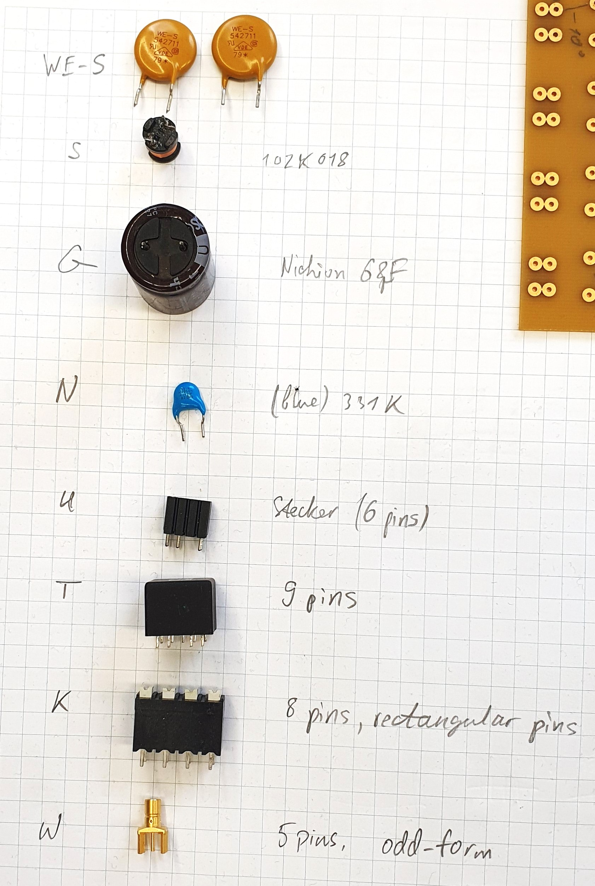
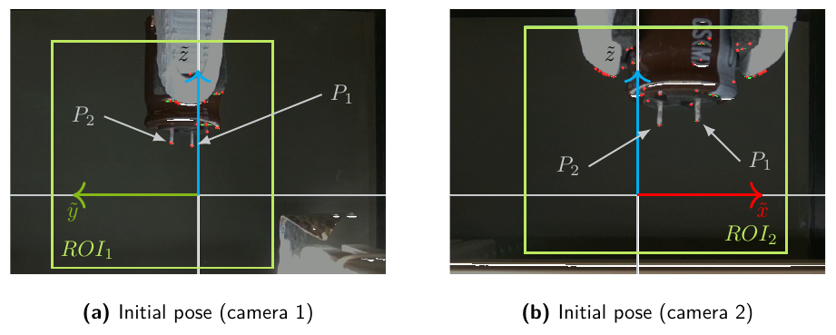

# **SmartAssembly**

**Code described in the PhD thesis "Flexible Multi-Sensory Robotic Systems for THT Assembly in Low-Volume High-Mix Production" by Mikhail Polikarpov (2026).**

An experimental framework for low-cost robotic assembly of Printed Circuit Board (PCB) with through-hole devices (THD), supported for any robot that has Cartesian control and Robot Operating System (ROS) support.

## Description


In this project, a visual-calibration technique is developed for localizing the pin tips of the THD w.r.t. the robot
end-effector and approaching the goal location on the PCB. 
Furthermore, a vision-based algorithm is developed for fine adjustment
movement before the insertion. For detailed information about the visual servoing algorithm, [see the docs](vision_system_readMe.md).

This repository provides example for two robots (For documentation click the hyperlink): 
- [ABB YuMi](Yumi_ReadMe.md) (7-DoF Dual-arm robot). 
- [Hexaglide](Hexaglide_ReadMe.md) (6-DoF parallel robot) made by [SFA GmbH & Co KG](https://sfa-aichstetten.de/en/).

## Main Features
- Assembly of Single In-line Package (SIP), Dual In-line Package (DIP) and (some) odd-shaped components.
- Multiple robot compatibility with ROS (Melodic) architecture.
- Movements in end-effector Cartesian coordinates.
- Visual referencing for THD pin localization.
- Grasping angle correction for SIP components.
- Convenient teach-in goal location through vision system.
- Contact force detection for safe manipulation.
- Vision-based fine adjustment movements (accurate up to 0.1 mm) for aligning pin over the goal position.
- Spiral search strategy with and without lifting contact in case of uncertain goal position.

## Installation

This repository is tested on [Ubuntu 18.04](https://releases.ubuntu.com/18.04/) and [ROS Melodic](https://wiki.ros.org/melodic/Installation/Ubuntu).

Recommended installation using Docker: [Instructions](Docker_ReadMe.md)

## User Guide

The ROS package `tht_control` contains the files that are required to run the environment for the THT assembly task. 
An overview of important files from this package:

### 1. Configuration Files
There are two configuration files, `config_hexaglide.yaml` and `tht_insertion_plan.yaml` located in the `src/tht_control/config` folder, that are
used to define various environment parameters. 

#### `config_hexaglide.yaml` Parameters:
- `env_param`: Describes the environment parameters. Some important parameters are:
  - `action_dict`: A dictionary for the discrete movement steps for the Hexaglide.
  - `translation_step_mm`: (Default: 0.5mm) Stepsize for the discrete movements (actions) in millimeters.
  - `max_pressure`: (Default: 700g) Maximum allowed pressure (in grams) during the insertion process.
  - `max_depth`: (Default: 2.1mm) Maximum depth in millimeters of insertion
  - `click_goal_image`: Enable this parameter for selecting the goal in the camera images
  - `goal_pixel_img1` / `goal_pixel_img2`: Pixel values for the goal in camera 1 and camera 2 image.
  - `vertical_shift_cam1` / `vertical_shift_cam2`: To compensate for camera mounting error, the vertical shift (in pixels) in camera1 and camera2 is added to goal pixels (optional).
  - `horizontal_shift_cam1` / `horizontal_shift_cam2`: To compensate for camera mounting error, the horizontal shift (in pixels) in camera1 and camera2 is added to goal pixels (optional).
  
    Note: Vertical/Horizontal shifts can be dependent on the goal position. 
- `ros_param`: List of topic for ROS communication
- `robot_workspace`: Defines the environment working space for the robot (Units: meters and degrees). Parameter `tildaorigin_to_pcb_z` is the distance from tilda origin to PCB surface along (Tilda) Z-axis. 
- `log_param`: Logging directory
- `cropped_image_pixels`: Defines the pixels of the cropped images for Metallic Pixel Detection.

#### `tht_insertion_plan.yaml` Parameters:
- `tht_components/component_dict`: Dictionary of the THD. Dictionary format: `THT Component ID: [Component package, Number of pins, Pins separation]`.
- `insertion_plan`: Contains the part ID (`part_ID`) for the THD to be inserted and part orientation angle on the PCB (`part_reorientation_angle`).

### 2. THT Insertion Task Script
The class `THTVisualServo` in the script `src/tht_control/scripts/tht_mpd_vsi_advanced.py` integrates the components from the `vision` and `hexaglide_tht_control` packages
for achieving the THT insertion task.

#### Overview of `THTVisualServo` methods:
- `__init__`: 
  - Reads the parameters from the configuration files.
  - Initialise `VisualServo`, `MetallicPixelDetection` and `GoalPixelSetter` class.
  - Initialise `Observer` class, defined in the file `src/tht_control/src/tht_control/observer.py`. This class is used for sensors data acquisition.
- `_set_init_pose`:
  - Visual referencing using class methods `moveToTildaOrigin` and for SIP parts, grasping angle correction with the method `graspingAngleErrorCompensation`.
  - Once the visual referencing is completed, the class method `approachGoal` brings the controlled pin near the goal position and `approachCorrection` corrects 
    the approach position.
  - To run the program in automatic mode (without user input), set ``wait_for_input`` to False.
- `_set_visual_servo_cmd`: Publishes the visual servo commands.
- `_set_action`: Publishes the action commands.
- `_get_obs`: With the `Observer` class, get the current robot state and sensor data.
- `_is_done`: Check for termination condition.
- `log_step`: Logs the environment state and the robot movements.

#### Main Function
After the approach correction, the main (continuous) while loop is initialised. 

In the while loop, the method `mpd` from class `MetallicPixelDetection` is used to correct the THD pin position. 

During the insertion phase, if the goal position is incorrect, there is contact force between the pin and the PCB. If the contact force is 
greater than `search_cycle_trigger_pressure`, the robot moves according to a defined search strategy around the goal position to find the hole.
The search strategy is defined by the list `movement_cycle` in the main function. The list contains discrete movement steps (actions) as described in the config file ``tht_control/config_hexaglide.yaml``
by the parameter ``env_param/action_dict``.

### 3. Launching the Project

You will need access to the lab PC (Dell Precision Tower 7910) and a laptop with an Ethernet port.

Turn on the lab PC and wait till GRUB gives you boot options. Select "Ubuntu".

The best way to launch the project is to navigate to the ``pycharm...`` folder in home directory, then go to ``bin`` folder, open terminal and enter the command to start PyCharm with sudo access:
```
sudo ./pycharm.sh
```

To launch the insertion task, 7 terminal tabs with sudo access need to be opened from the repository directory. The tabs are normally already opened preconfigured in PyCharm environment. To gain sudo rights if necessary, type ``sudo`` in the Ubuntu
terminal and enter the credentials (if needed). 

Source the setup.bash in all tabs by entering the command (or finding the command by pressing the up-arrow button in the terminals to browse previously used commands):
``` 
source devel/setup.bash
```

Turn on the LED light stripes.

Turn on the Franka Emika Panda robot and wait till the lights at its base stop blinking (meaning that the controller server has been started).

Make sure the Hexaglide machine is connected to the power supply.

The sequence of starting the project modules in PyCharm is important. To ensure there is no problems with the program, the following 
launch sequence is recommended:

#### 1. Initialize Intel RealSense cameras with ROS
- Two Intel RealSence D405 cameras are used for visual servoing of THT assembly.
- Connect the cameras with USB ports (USB3 for higher bandwidth). To ensure that Linux/Ubuntu directly recognizes the cameras as connected per USB 3.2 instead of USB 2.1, remove and then directly insert back the USB cables attached to the lab PC (thick black cables).
- Before starting the launch files for cameras, ensure the camera settings are correct:
  - Launch Intel RealSense Viewer by running the following command in a terminal (exact terminal doesn't matter, but simply start in the ``cam_1`` terminal)
    ```
    realseanse-viewer
    ```
  - If both the RealSense cameras are not visible on the left panel, click on 'Add Source' and select the cameras.
  - To check the settings, do not turn on the cameras. Click on the 'Stereo Module' drop down menu.
  - Warning: there will be error messages when changing camera parameters - press OK 4 times to make them go away. Don't worry - this doesn't impact the performance of the cameras.
  - Unselect Depth Z16 datastream (to ensure highest bandwidth of RGB image stream).
  - Change the value of 'Resolution' to ``1280 x 720``.
  - Unselect 'Enable Auto Exposure' and click on 'Controls' drop down menu.
  - Change the value of 'Exposure' to ``5000``. Important: if the exposure is higher, the images will be overexposed and false detections of pin tips will occur!
  - Close RealSense Viewer once you've adjusted the parameters.
- To launch the cameras:  
  -   From first terminal, launch camera 1 (camera id: 127122270605):
      ```
      roslaunch realsense2_camera rs_camera.launch serial_no_camera1:=127122270605 camera:=cam_1
      ```
  -   From second terminal, launch camera 2 (camera id: 130322272098):
      ```
      roslaunch realsense2_camera rs_camera.launch serial_no_camera1:= 130322272098 camera:=cam_2
      ```
- Optional: To verify that cameras launched properly, in a new terminal type ``rostopic list``, if ``cam_1/color/image_raw`` and ``cam_2/color/image_raw`` topics are available, then cameras have launched.
- If the camera topics are not available, following troubleshooting steps can be applied:
  - Check the cameras' connection.
  - Check if the camera serial number provided in the launch files arguments are correct. 
  - Stop the launch files (press ctrl+C) and reconnect the cameras. Relaunch the cameras and check if the problem is resolved.

#### 2. Initialize ELP Camera
- A third camera (ELP) can be used to observe the insertion from a different angle.
- In the third terminal tab, start the ELP cameras with following command:
    ```
    roslaunch usb_cam usb_cam-test.launch
    ```
- You can either close of minimize the video stream window from this camera, this doesn't matter. For convenience and just in case you want to look closer without leaving the table, it is recommended to just minimize the windiw.

#### 3. Initialize Phidget Pressure Sensors

#### _Optional, never needed: Sensor Calibration_
-   To recalibrate the pressure sensors, open the terminal from 'smartassembly_ws' and type the following command:
    ```
    rosrun phidget_sensor record_sensor_weights.py 
    ```
-   Follow the instructions of the script. Basically, you need a couple (ideally more than 5) known weights (in grams) you can put on top of the PCB.
-   A file containing weights for the conversion of sensor voltage to force is created in the 
   ``~/smartassembly_ws/src/phidget_sensor/sensor_weights`` folder. The file is created with a timestamp.

#### _Publishing Pressure Sensor Value_
-   Optional (after recalibrations): Select the desired weight file by changing the parameter ``weights_list_filename`` in the ``config_hexaglide.yaml`` file in ``vision`` package.
-   From the third terminal tab, execute the ``pressure_sensors.py`` file to initialize a rostopic that publishes pressure value at 25Hz rate on topic '/pressure'.
    ```
    rosrun phidget_sensor pressure_sensors.py
    ```
- Follow the instruction to calculate tare value of the pressure sensors and to start publishing ROS topics.

#### 4. Initialise the Hexaglide

- In the next terminal, run the program for ROS communication.
    ```
    rosrun tht_control hexaglide_sub_pub
    ```
- When the program is launched, the option for referencing the Hexaglide will be presented. MAKE SURE THAT NO FOREIGN OBJECTS OR BODY PARTS ARE IN THE WORKSPACE OF THE ROBOTS!!! Follow the instructions on the screen.

#### 5. Prepare THT component using Franka Emika Panda robot arm

- Now you will need a laptop (Windows) with an Ethernet port to connect to the Panda robot.
- On Windows, go to:
  - Control panel
  - Network and Internet
  - Network and sharing center
  - Change adapter settings (of the Ethernet connection)
  - Properties
  - IPv4
  - Set IP ``172.16.0.1`` and netmask ``255.255.255.0``
- Connect Ethernet cable between Panda and your laptop.
- Go to a browser, type ``172.16.0.2`` in the address field, proceed to "unsafe" website.
- If necessary for login, username: ``IPS``, password: ``$martA$$embly``.
- In the right panel of the Desk environment that opens up:
  - On the top right, select the second guide mode (guiding by the gripper/EEF of the robot and buttons on it).
  - Unlock robot joints (warning: the robot will release the brakes and will move slightly, it will be ready once the movement stops).
  - You can now use the four buttons on top of the gripper of the robot (in the central circle) to open/close the gripper slowly/rapidly. DO SO WITH CARE AND WITHOUT PUSHING THE BUTTONS AND THE GRIPPER TOO HARD!
  - Also you can choose between Free moves, Translation and Rotation modes to guide the robot by the gripper. To move the gripper, press the pair of grey buttons located on the side of the gripper and move it while holding the buttons pressed together. DO IT GENTLY. Translation and Rotation modes are recommended as they make preparing the THT component position and orientation easier.
  - See step 7 for more details on which components to use. Part G (brown cylindrical capacitor) is recommended as it is the easiest one to demonstrate (easy handling).
- In case of **SIP** (2 pin) components, make sure that both pins are visible by both cameras (not occluded). See step 7 for an example image and more details on where to put the component in space.
- Orient a 2-pin component in such way that the line through both pin tips points within +/- 20 degrees of the main optical axis of camera 2. Outside of this range, the rotation would be too large for the Hexaglide.
- For a **DIP** component (with 2 rows of pins): put it in the gripper of Panda robot, use Free moves mode to guide the robot until the component is inserted in the PCB (this ensures correct orientation of Panda gripper). Then, use Translation mode to move the gripper back out, preserving correct orientation. See step 7 for more details on where to put the component in space.

#### 6. Visualisation

- Lastly, for visualisation, launch the ROS Graphical User Interface (GUI):
  ```
  rosrun rqt_gui rqt_gui
  ```
- There is a saved GUI perspective that can be loaded.
  - Click on the 'Perspective' drop down menu.
  - Select ``rqt_gui_cam3`` from the list. (If not directly selectable, select some other perspective and then ``rqt_gui_cam3`` again)
- **ATTENTION**: Check that the following signals are as they should be:
  - Images from both cameras are live (noticeable by slight flickering due to 50 Hz net frequency).
  - Images from both cameras are of same brightness and rather dark - if not, retry step 1 for D405 camera setup.
  - **Important for successful demonstration**: Make sure that the approximate position and orientation range of THT components described in step 5 is correct.
  - The pressure curve is running and is approximately 0 grams.

#### 7. Launch the THT Insertion Environment

- Once all the other modules of the project have launched successfully, the insertion environment can be started.
- Before starting the program, ensure following requirements are fulfilled.
  - The correct ``insertion_plan/part_ID`` is selected in the `tht_insertion_plan.yaml`

    

  - The part pins are within the ROI of the RealSense cameras.

      

  - For **parts with 2 pins** (single in-line pin, **SIP**): pin tips must be within ROI but above the horizontal image center line (for visibility reasons)
  - For **parts with > 2 pins** (dual in-line pin, **DIP**): pin tips should be below the horizontal image center line for correct recognition (but also within ROI, so pretty close to the intersection of cameras' optical axes).
  - If choosing a goal position by teach-in, the ``env_param/click_goal_image`` is True, else False.
  - If using the saved goal pixel values, ensure that correct values are provided in the parameters ``env_param/goal_pixel_img1`` and ``env_param/goal_pixel_img2``
- To run the program, enter the following command in the next terminal tab
  ```
  rosrun tht_control tht_mpd_vsi_advanced.py --robot_type hexaglide
  ```
- **ATTENTION**: Make sure that there are no other objects or parts on the PCB, especially in the desired insertion location! This would lead to a collision.
- Carefully confirm whenever the program asks in the terminal (type y or n and then enter to accept or to reject).
- It is possible that for large reset movements ``hexaglide_sub_pub`` terminal also needs to be opened again and the movement command confirmed with "y".

#### 8. Turning the system off

- You can simply close PyCharm to stop all running ROS processes.
- Shutdown the lab PC.
- Before wrapping up, remove any THT components held by Panda from its gripper and put them back on the table. 
- **ATTENTION**: Lock the joints of Panda from the Desk environment on your laptop. Otherwise the robot will jerk when turned off and might damage other equipment.
- Then, press the off switch on the Panda robot controller. Disconnect your laptop.
- Disconnect LED stripe from power supply.
- Disconnect Hexaglide from power supply.
